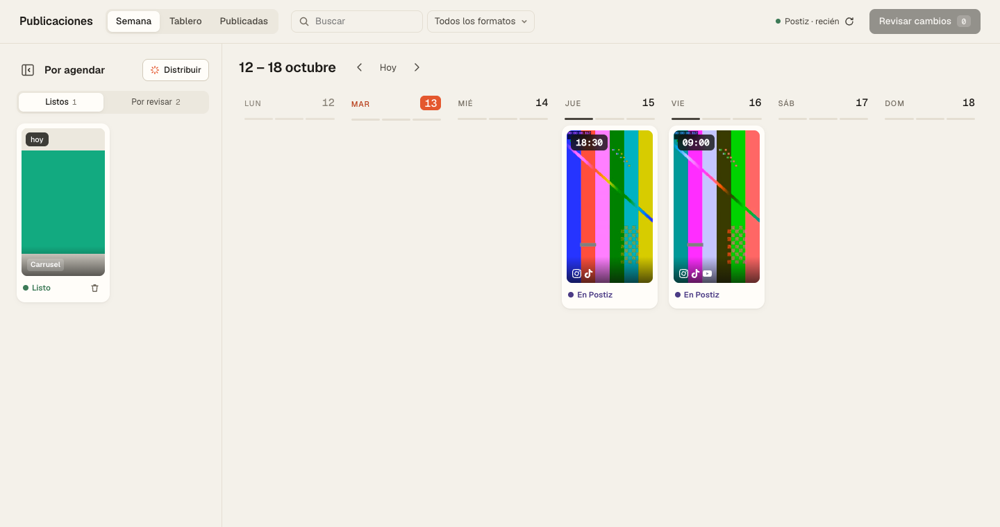

# Planner de contenido

Un calendario local para organizar y programar tus publicaciones en Instagram, TikTok, YouTube, LinkedIn, Facebook, X, Threads, Bluesky, Pinterest y cualquier otra red que conectes en [Postiz](https://postiz.com). Lo manejás desde el navegador y lo ejecuta [Claude Code](https://claude.com/claude-code).

- Ves tus piezas como portadas: lo que está en desarrollo, lo que falta revisar, lo listo y lo que ya salió.
- Arrastrás cada pieza a un día y una hora, elegís en qué redes sale y desde qué cuenta.
- Dejás feedback escrito o con audio sobre cada video, para que Claude Code lo corrija.
- Planificás tus historias de Instagram en una vista propia: la semana en filas, cada día con su secuencia, un editor tipo Canva y las respuestas de cada día.
- Revisás los guiones, audios, rough cuts y finales de la semana en la pestaña Guiones: aprobás, dejás feedback y elegís el look del avatar, el estilo y el título.
- Elegís qué producir con Referencias (el research de la semana y la base de competidores) y mirás cómo rinde cada cuenta en Métricas.
- Escribís y agendás tus posts de Twitter y LinkedIn, y en LinkedIn buscás prospectos y les hacés un video a medida.
- Cuando terminás, el planner arma un mensaje. Lo pegás en Claude Code y él programa todo en Postiz.



Nada se publica solo: el planner sólo propone. Programar, mover o pausar en Postiz pasa únicamente cuando vos pegás la confirmación en el chat.

## Instalación (con Claude Code)

1. Abrí Claude Code en la carpeta donde guardás tu contenido (o en la que quieras usar para empezar).
2. Pegá este mensaje:

   ```
   Instalá el planner de contenido de https://github.com/PauldeLavallaz/planner-de-contenido y guiame hasta tenerlo andando.
   ```

3. Claude Code clona el proyecto, revisa qué te falta instalar, te ayuda a conectar tu cuenta de Postiz, mira cómo tenés organizadas tus carpetas y te propone cómo leerlas. Al final te abre el planner en `http://127.0.0.1:4180`.

Necesitás una cuenta de Postiz con tus redes conectadas. Postiz en la nube no tiene plan gratis (tiene una prueba de 7 días y planes según la cantidad de cuentas); también se puede instalar en un servidor propio, pero hay que registrar apps de desarrollador en cada red. Claude Code te guía también en eso.

> **Para Claude Code:** si te pasaron este link para instalar el planner, cloná el repositorio (`git clone https://github.com/PauldeLavallaz/planner-de-contenido.git`) en la carpeta que el usuario elija y seguí [INSTALAR.md](INSTALAR.md) paso a paso. Las reglas de trabajo están en [AGENTS.md](AGENTS.md).

## Cómo se usa, día a día

1. **Producís** como siempre, en tus carpetas. El planner las lee sin modificarlas.
2. **Revisás** en el Tablero: pasás cada pieza de *Por revisar* a *Listo* cuando apruebes el final, o le dejás feedback.
3. **Agendás** en la vista Semana: arrastrás las piezas listas a un día, o usás *Distribuir* para repartirlas solas en tus horarios.
4. **Confirmás**: *Revisar cambios* → *Preparar confirmación* → *Copiar mensaje*, y lo pegás en Claude Code.
5. Claude Code programa en Postiz, y el planner muestra cada pieza como *En Postiz* y, cuando sale, como *Publicada*.

Más detalle en [docs/como-funciona.md](docs/como-funciona.md).

## Historias

La pestaña **Historias** muestra la semana de historias en filas: un día por fila, sus historias una al lado de la otra y el recurso del día a la derecha. Elegís por día si sale por Postiz o no sale, a qué hora y desde qué cuenta; reordenás arrastrando, cambiás una secuencia de día (también a otra semana; si el día ya tiene otra, intercambian), dejás un día libre corriendo todo uno para abajo o descartás una secuencia; ves qué salió en los días que ya pasaron; cargás las respuestas de cada día; y abrís cada historia para editarla en un editor tipo Canva (con video de fondo, voz en off que grabás leyendo el guion, recursos como un chat de WhatsApp, recortes y grupos) o dejarle feedback con audio. **Programar** junta todo lo pendiente, de todas las semanas y cuentas, en un solo mensaje. Todas salen por Postiz, en cadena: la primera programada y cada una de las siguientes apenas se publica la anterior, así Instagram las muestra en orden. Se diseñan sin stickers interactivos (el pedido va escrito: «Respondé…»), porque Instagram no deja ponerlos por la API.

Las historias se arman con el motor de `motor-historias/` (HTML → imagen, con un chequeo de zonas seguras y contraste). Pedile a Claude Code «armá la semana de historias». Detalle en [docs/historias.md](docs/historias.md).

## Guiones

La pestaña **Guiones** muestra el contenido de la semana mientras se produce: cada pieza con su título en pantalla, su estilo, el audio, el rough cut o el final para mirar ahí mismo, el guion y el copy. Aprobás lo que está bien, dejás feedback escrito o grabado, pausás o descartás, y con tres botones elegís el look del avatar (una foto por look en `looks/`), el estilo del B-roll (una biblioteca que va aprendiendo de tus favoritos) y el tipo de título. «Copiar feedback para Claude Code» arma el mensaje con todas las notas. Cada semana es un `plan.json` con una carpeta por pieza en `guiones/`: pedile a Claude Code «armá los guiones de la semana». Detalle en [docs/guiones.md](docs/guiones.md).

## Referencias y Métricas

**Referencias** es dónde decidís qué producir: la **Bandeja** junta el research de la semana y lo que mejor les funcionó a las cuentas que seguís; en la **Selección** queda lo elegido, con lo que propone Claude Code; y **Competidores** es la base de cuentas con su ficha y sus contenidos. «Pedir guiones» manda lo elegido a la pestaña Guiones. La base la llena Claude Code con la skill `competidores` (con tu clave de ScrapeCreators). Detalle en [docs/referencias.md](docs/referencias.md).

**Métricas** es tu centro de control: por cuenta, los seguidores semana a semana, lo que mejor funcionó en el período y qué formatos y temas rinden. Sale de Postiz y de lo que cargues a mano o por CSV. Detalle en [docs/metricas.md](docs/metricas.md).

## Twitter y LinkedIn

**Twitter**: la semana para agendar, los borradores como se ven en X (los hilos, editables ahí mismo), los bookmarks y las búsquedas que los alimentan y una base de cuentas. Pedile a Claude Code «configurá Twitter» y después «armá borradores de Twitter». Detalle en [docs/twitter.md](docs/twitter.md).

**LinkedIn**: prospectos (empresas o personas que buscan lo que vos ofrecés), un video a medida para cada uno con su recorrido de Elegir a Enviados, los posts con su imagen, sus métricas y las referencias de lo que funciona. Nada se manda a nadie desde el planner: invitar y escribir lo hacés vos. Detalle en [docs/linkedin.md](docs/linkedin.md).

## Anuncios y avisos

- **Anuncios**: en Publicadas elegís los videos que querés pautar y Claude Code los sube a una carpeta compartida (Google Drive u otra, con rclone). Ver [docs/como-funciona.md](docs/como-funciona.md#el-detalle-de-una-pieza).
- **Avisos por Telegram**: con un bot propio, te llegan las historias del día para subirlas a TikTok, los avisos de la publicación en cadena y el copy de TikTok cuando un borrador llega a tu bandeja. Ver [docs/historias.md](docs/historias.md#avisos-por-telegram).

## Tus carpetas

El planner se adapta a cómo ya trabajás. Dos formas:

- **Carpetas por estado** (la estructura estándar): `1-en-desarrollo/`, `2-por-revisar/`, `3-listo/`, `4-publicado/`. Cada pieza es una carpeta adentro, con su video o sus láminas.
- **Tu propia estructura**: le decís dónde están tus piezas (por ejemplo `Reels/2026/*`) y el estado sale del planner o de un archivo `pieza.json`.

Claude Code analiza tus carpetas durante la instalación y te recomienda una. Ver [docs/carpetas.md](docs/carpetas.md).

## Requisitos

- macOS, Windows o Linux.
- [Node.js](https://nodejs.org) 22.18 o más nuevo, y Python 3.10 o más nuevo.
- El CLI de Postiz: `npm install -g postiz`.
- ffmpeg (opcional, para portadas de video y notas de voz).
- Para historias (opcional): `pip install playwright pillow numpy` y `python3 -m playwright install chromium`.

`python3 engine/doctor.py` chequea todo y dice cómo instalar lo que falte.

## Qué hay adentro

| Carpeta | Qué es |
|---|---|
| `app/` | El planner: servidor local (Node) e interfaz web. |
| `engine/` | El motor en Python: inventario de tus carpetas, cola de publicación, conexión con Postiz, avisos por Telegram, anuncios, y lo de Twitter (`x/`), LinkedIn (`linkedin/`) y el research (`research/`). |
| `motor-historias/` | El motor de historias: plantilla, estilos y render a imagen. |
| `.claude/skills/` | Instrucciones para Claude Code: instalar, organizar carpetas, publicar, historias, guiones, competidores y referencias, Twitter y LinkedIn. |
| `.claude/hooks/` | El hook que titula cada conversación con la primera línea del mensaje que copia el planner (se activa en `.claude/settings.json`). |
| `docs/` | Cómo funciona, carpetas, historias, guiones, Twitter, LinkedIn, referencias, métricas y particularidades de cada red. |
| `tests/` | Pruebas del motor contra un Postiz simulado. |

Tu configuración (`planner.config.json`) y tus credenciales (`.env`) quedan sólo en tu computadora; no se suben al repositorio.

## Comandos útiles

```bash
python3 engine/doctor.py                 # qué falta instalar o configurar
python3 engine/conectar.py --verificar   # vuelve a leer tus cuentas de Postiz
python3 engine/carpetas.py probar        # qué piezas ve el planner y en qué estado
python3 engine/cola.py semana            # la semana que viene, como texto
cd app && npm run service:status         # si el planner está corriendo
```

## Licencia

MIT. Ver [LICENSE](LICENSE).
