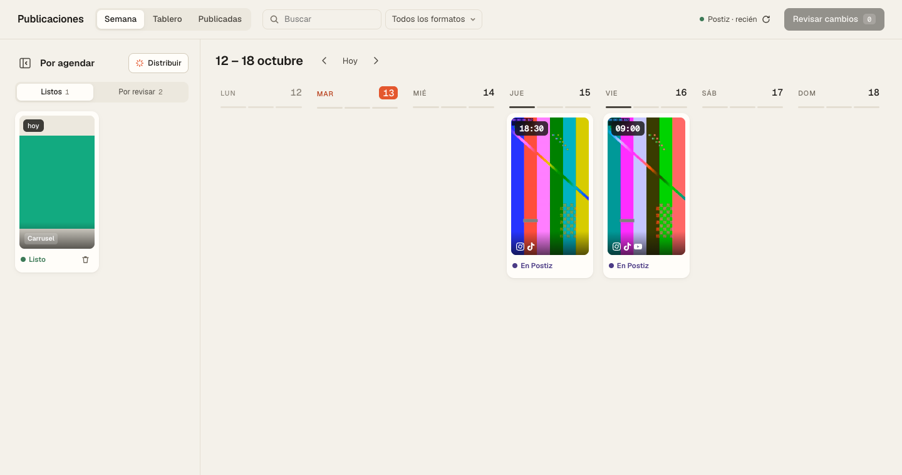

# Planner de contenido

Un calendario local para organizar y programar tus publicaciones en Instagram, TikTok, YouTube, LinkedIn, Facebook, X, Threads, Bluesky, Pinterest y cualquier otra red que conectes en [Postiz](https://postiz.com). Lo manejás desde el navegador y lo ejecuta [Claude Code](https://claude.com/claude-code).

- Ves tus piezas como portadas: lo que está en desarrollo, lo que falta revisar, lo listo y lo que ya salió.
- Arrastrás cada pieza a un día y una hora, elegís en qué redes sale y desde qué cuenta.
- Dejás feedback escrito o con audio sobre cada video, para que Claude Code lo corrija.
- Planificás tus historias de Instagram en una vista propia: la semana en filas, cada día con su secuencia, un editor tipo Canva y las respuestas de cada día.
- Cuando terminás, el planner arma un mensaje. Lo pegás en Claude Code y él programa todo en Postiz.



Nada se publica solo: el planner sólo propone. Programar, mover o pausar en Postiz pasa únicamente cuando vos pegás la confirmación en el chat.

## Instalación (con Claude Code)

1. Abrí Claude Code en la carpeta donde guardás tu contenido (o en la que quieras usar para empezar).
2. Pegá este mensaje:

   ```
   Instalá el planner de contenido de https://github.com/PauldeLavallaz/planner-de-contenido y guiame hasta tenerlo andando.
   ```

3. Claude Code clona el proyecto, revisa qué te falta instalar, te ayuda a conectar tu cuenta de Postiz, mira cómo tenés organizadas tus carpetas y te propone cómo leerlas. Al final te abre el planner en `http://127.0.0.1:4180`.

Necesitás una cuenta de Postiz con tus redes conectadas. Postiz en la nube no tiene plan gratis (tiene una prueba de 7 días y planes según la cantidad de cuentas); también se puede instalar en un servidor propio, pero hay que registrar apps de desarrollador en cada red. Claude Code te guía también en eso.

> **Para Claude Code:** si te pasaron este link para instalar el planner, cloná el repositorio (`git clone https://github.com/PauldeLavallaz/planner-de-contenido.git`) en la carpeta que el usuario elija y seguí [INSTALAR.md](INSTALAR.md) paso a paso. Las reglas de trabajo están en [AGENTS.md](AGENTS.md).

## Cómo se usa, día a día

1. **Producís** como siempre, en tus carpetas. El planner las lee sin modificarlas.
2. **Revisás** en el Tablero: pasás cada pieza de *Por revisar* a *Listo* cuando apruebes el final, o le dejás feedback.
3. **Agendás** en la vista Semana: arrastrás las piezas listas a un día, o usás *Distribuir* para repartirlas solas en tus horarios.
4. **Confirmás**: *Revisar cambios* → *Preparar confirmación* → *Copiar mensaje*, y lo pegás en Claude Code.
5. Claude Code programa en Postiz, y el planner muestra cada pieza como *En Postiz* y, cuando sale, como *Publicada*.

Más detalle en [docs/como-funciona.md](docs/como-funciona.md).

## Historias

La pestaña **Historias** muestra la semana de historias en filas: un día por fila, sus historias una al lado de la otra y el recurso del día a la derecha. Elegís por día si sale por Postiz, a mano o no sale, a qué hora y desde qué cuenta; reordenás arrastrando o corrés una secuencia a otro día (también a otra semana); cargás las respuestas de cada día; y abrís cada historia para editarla en un editor tipo Canva o dejarle feedback con audio. Las historias con encuesta, link o caja de preguntas quedan marcadas para subirlas a mano, porque Instagram no deja publicarlas por la API.

Las historias se arman con el motor de `motor-historias/` (HTML → imagen, con un chequeo de zonas seguras y contraste). Pedile a Claude Code «armá la semana de historias». Detalle en [docs/historias.md](docs/historias.md).

## Tus carpetas

El planner se adapta a cómo ya trabajás. Dos formas:

- **Carpetas por estado** (la estructura estándar): `1-en-desarrollo/`, `2-por-revisar/`, `3-listo/`, `4-publicado/`. Cada pieza es una carpeta adentro, con su video o sus láminas.
- **Tu propia estructura**: le decís dónde están tus piezas (por ejemplo `Reels/2026/*`) y el estado sale del planner o de un archivo `pieza.json`.

Claude Code analiza tus carpetas durante la instalación y te recomienda una. Ver [docs/carpetas.md](docs/carpetas.md).

## Requisitos

- macOS, Windows o Linux.
- [Node.js](https://nodejs.org) 22.18 o más nuevo, y Python 3.10 o más nuevo.
- El CLI de Postiz: `npm install -g postiz`.
- ffmpeg (opcional, para portadas de video y notas de voz).
- Para historias (opcional): `pip install playwright pillow numpy` y `python3 -m playwright install chromium`.

`python3 engine/doctor.py` chequea todo y dice cómo instalar lo que falte.

## Qué hay adentro

| Carpeta | Qué es |
|---|---|
| `app/` | El planner: servidor local (Node) e interfaz web. |
| `engine/` | El motor en Python: inventario de tus carpetas, cola de publicación y conexión con Postiz. |
| `motor-historias/` | El motor de historias: plantilla, estilos y render a imagen. |
| `.claude/skills/` | Instrucciones para Claude Code: instalar, organizar carpetas, publicar e historias. |
| `docs/` | Cómo funciona, carpetas, historias y particularidades de cada red. |
| `tests/` | Pruebas del motor contra un Postiz simulado. |

Tu configuración (`planner.config.json`) y tus credenciales (`.env`) quedan sólo en tu computadora; no se suben al repositorio.

## Comandos útiles

```bash
python3 engine/doctor.py                 # qué falta instalar o configurar
python3 engine/conectar.py --verificar   # vuelve a leer tus cuentas de Postiz
python3 engine/carpetas.py probar        # qué piezas ve el planner y en qué estado
python3 engine/cola.py semana            # la semana que viene, como texto
cd app && npm run service:status         # si el planner está corriendo
```

## Licencia

MIT. Ver [LICENSE](LICENSE).
